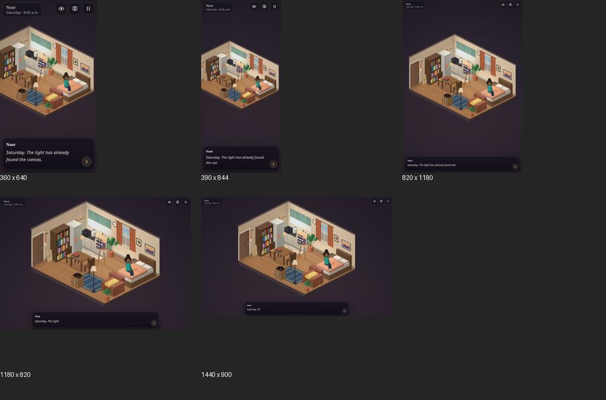

# Story Edition production review

Baseline `1c9e1f9224e08d00957f9a46017d7b279205fe46`. PR 36 is the most recent merged change. The [main push run](https://github.com/RileyTheRiler/being-found/actions/runs/45540269002) passed. Vercel returned that SHA, production target, READY and the public alias for deployment `dpl_56ryNMS5TZtNBjtmcE47v81s2XND`.

## Play evidence

Root production build, local Chromium. Started at New story and reached the title after all seven chapters. Used the rendered object buttons by keyboard and clicked the rendered action, choice, phone and dialogue buttons. The driver read chapter and input readiness for synchronization. It never called a debug action. Accelerated story clock, instant dialogue, reduced motion. Noor took the sign, went downstairs, spoke to Mara and went home without knocking. Leena shelved two books and locked up without reading either recollection. Dele answered his phone and turned off the lamp. Mara visited Walt and left. Noor returned to the street and joined Mara. All seven IDs appeared in completed. This establishes one route. It does not measure player reading time.

Five separately loaded ordinary-speed openings. At 360 and 390 the left edge of the flat falls outside the frame. On tablet portrait the lower gap between bed and dialogue occupies much of the available space. Desktop shows the whole bed, easel and exit. A separate 120-frame desktop sample during opening dialogue gave 16.7 ms median and 33.4 ms p95 between animation frames. Headless Linux, software rendering, one scene. A short opening audio stream was captured; listening quality remains unassessed. No physical device or human participant sessions.

## Scores

These are editorial judgments for this build. Audio is a provisional implementation score. Movement and accessibility scores have limited coverage.

|Area|Weight|Score / 10|Observation|
|---|---:|---:|---|
|Immersion|15|6|The lit windows and the return to Ferro’s establish a place. A Notebook banner interrupts the street-to-flat cut.|
|Narrative|15|6|Noor’s sign gives her a reason to visit Leena. The next Saturday reports a birthday that is still a day away.|
|Interaction|15|5|Shelving carries a book to a shelf and changes the cart. Most inspections produce dialogue and the same advance command.|
|Visuals|10|6|The striped awning and the bedroom easel orient the player. Small portrait framing loses furniture at the edge.|
|Animation and camera|10|5|The rig supports object carrying; sitNow and standNow relocate the figure directly. Individual pose alignment needs motion review.|
|Philosophical integrity|10|6|Noor’s refusal to knock leaves Dele playable. Later recaps can invent a knock or a spoken remark.|
|UI and UX|8|5|Speaker names and separate action labels work on the played route. Two controls promising resume have different effects.|
|Audio and music|7|5|Separate buses, cues for books and a shared musical motif. The sound of the mix on speakers and headphones remains ungraded.|
|Accessibility|5|5|Semantic object buttons supported the completed route. Content text promises a skip from Chapters which that menu does not offer.|
|Technical reliability|5|5|The normal campaign completes. Resuming through Chapters overwrites a valid v1 checkpoint; smoke tests bypass the menu.|
 
Weighted total **5.50/10**. Arithmetic: sum of weight times score, divided by 100. The score is provisional until the remaining branches, motion, audio and access checks are complete.

## Findings and production order

|Priority and location|Observation and underlying cause|Change and acceptance test|
|---|---|---|
|High · Chapters, 70-script|From the same Noor hall save, Continue retained hall. Chapters → Resume immediately wrote null and showed the Chapter One card. Its handler calls the replay routine.|Share checkpoint restoration. Test hall and street via both menus, reload, verify earlier choices and a different edition’s save survive.|
|High · library, 91/92|Home produced a Notebook entry saying Noor had knocked. The note outcome also shares the knock introduction. A knock followed by leaving can produce the same outcome as leaving immediately.|Record action separately from outcome. Verify direct note, note after knock, direct home, home after knock, refusal, invitation and skipped encounter. Report only what Noor tells Leena.|
|High · workshop and street, 94/95|Front door is gated on toastDone. Saturday dialogue reports a toast delivered on the following Sunday, including after skipping Walt.|Allow Walt to put the card aside; allow leaving. On Saturday give Walt a reason to stop at the bakery before the party. Prove both ending paths without assuming performance.|
|High · chapter selection, 70|Replay restores the latest global flags; a previously satisfied explore-until condition can terminate a replay immediately.|Keep chapter-entry snapshots. Define migration for legacy records. Compare a second play with a fresh chapter while preserving only earlier decisions.|
|High · menu and cards, 60/70|Content notice advertises skipping later from Chapters, which renders only Play/Resume. Pause offers no general skip.|Add a clearly named, untimed current-chapter skip with tested defaults and focus return, including the last chapter.|
|Medium · epilogue, 95|After greeting Dele the Notebook always says he chose the bench, including after a silent nod. Both final walks store boolean true.|Record only the words heard. Retain short/long in state. Check Notebook and last caption for each choice.|
|Medium · opening, 90/60|Several captions narrate visible light changes; note acquisition raises a philosophy prompt over the scene.|Use one orientation caption and player-requested description. Keep Notebook reachable. Check silent and nonvisual routes and review a clean opening frame.|
|Medium · portrait camera, 40/60|The left wall clips at narrow widths while empty space separates scene and dialogue. Camera fit and panel reservation address different spaces.|Compare the same object before/after at all five sizes. Keep actor, action target and labels visible when a choice opens.|
|Medium · planner/phone, 60/89|Both use the same node with delayed unconditional cleanup. A rapidly opened later panel risks being cleared by an older timer.|Give each overlay an owner and cancel obsolete callbacks. Test closing planner then opening phone and skipping during a reply. Reproduction pending.|
|Medium · animation, 30/70|Walking uses a shared rig; seating snaps to the anchor after walking to a nearby point.|Record transitions from both approach directions. Inspect feet, seat contact and held items at normal speed and reduced motion.|
|Medium · Notebook, 85|The Same Door entry asserts Dele opened the door although the activity is optional. Source page ranges and quotations still need edition-level checking.|Use conditional or possibility-based wording. Check every direct quotation against a paginated copy before editorial sign-off.|

A full motion inventory, headphones/speaker listening, performance across active scenes, exhaustive branch coverage, and assistive technology observations remain open. The automation is a technical playthrough; no first-time player was observed.
